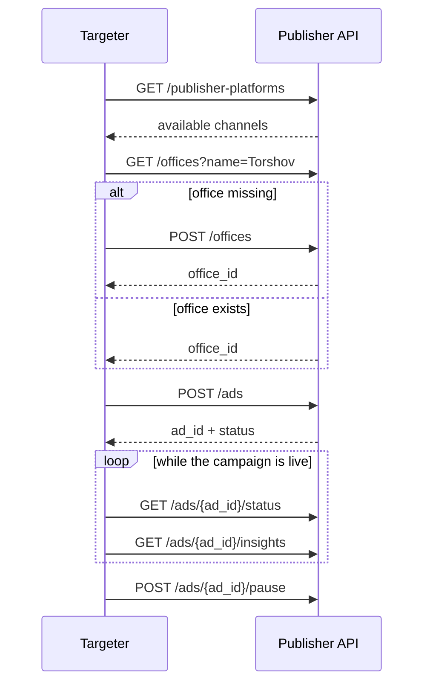

## What this is

Targeter’s partner API (under **Pages**) is how external systems call Targeter.

This section is the other direction: how **Targeter calls your API**. It is the ideal contract for publishers, media houses, and ad platforms that Targeter creates ads on and pulls reporting from.

If you implement these endpoints, Targeter can onboard your inventory without a custom adapter for every function.

## Base URL

All requests are made to the host you provide during setup:

```
https://{publisher_host}/v1
```

Use snake_case JSON, ISO 8601 dates (`YYYY-MM-DD`), and ISO 4217 currency codes.

## Authentication

Targeter sends a token you issue during [integration setup](/integrations/setup):

```
Authorization: Bearer <token>
```

## Ideal functions

Targeter expects this set of operations. Implement all of them unless a function is marked optional during onboarding.

<AccordionGroup>
    <Accordion title="Offices" icon="building">
        - **[Create office](/integrations/offices/create)** — create a broker/advertiser office; you generate `office_id`
        - **[Get office ID](/integrations/offices/get)** — resolve an existing office to its `office_id`
    </Accordion>
    <Accordion title="Ads" icon="rectangle-ad">
        - **[Create ad](/integrations/ads/create)** — create an ad under a Targeter campaign
        - **[Update ad](/integrations/ads/update)** — change budget, dates, targeting, creatives, or platforms
        - **[Delete ad](/integrations/ads/delete)** — permanently remove an ad
        - **[Pause ad](/integrations/ads/pause)** — stop delivery without deleting
        - **[Resume ad](/integrations/ads/resume)** — restart a paused ad
        - **[Get ad status](/integrations/ads/status)** — return current delivery status
    </Accordion>
    <Accordion title="Insights and platforms" icon="chart-line">
        - **[Fetch insight](/integrations/insights/fetch)** — return performance metrics for an ad
        - **[Get publisher platforms](/integrations/platforms/get)** — list channels Targeter may request
    </Accordion>
</AccordionGroup>

## Typical flow



## Errors

Match Targeter’s partner API: HTTP status codes plus a JSON body.

```json
{
    "error": "Invalid request payload",
    "details": [
        {
            "path": ["material", "target_url"],
            "message": "Target URL is required"
        }
    ]
}
```

Use **401** for missing or invalid tokens, **404** when an office or ad does not exist, and **409** when the current ad status does not allow the requested action.
